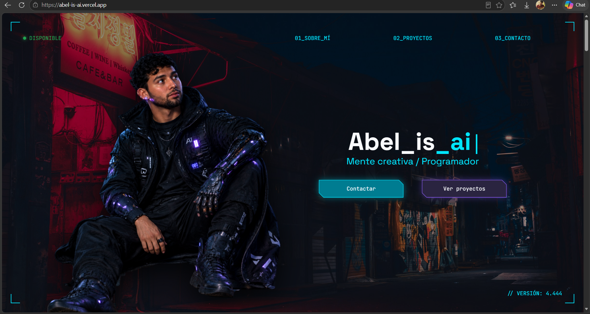

# Abel_is_ai

Portafolio personal de mis servicios como desarrollador web en Guadalajara, Jalisco. Presente mi perfil, mis proyectos y la forma en la que trabajo. De igual manera se añade un formulario al final de la página para que las personas puedan cotizar sus proyectos de manera rápida y accesible desde la aplicación de WhatsApp.

Tiene una estética futurista inspirada en una terminal: fondos oscuros, detalles en cyan y morado, tipografía monoespaciada y efectos *glitch*.

🔗 **Enlace:** https://abel-is-ai.vercel.app/

**Imagen de referencia**

---

## Tecnologías

- HTML5 semántico
- CSS3 con variables personalizadas (`:root`), `grid`, `flex`, `clip-path` y `color-mix()`
- JavaScript puro (ES Modules), sin librerías ni frameworks
- Fuentes: [Space Grotesk](https://fonts.google.com/specimen/Space+Grotesk) y [JetBrains Mono](https://fonts.google.com/specimen/JetBrains+Mono) (Google Fonts)
- Diseño en Figma 

## Cómo ejecutarlo en local

El proyecto usa módulos de JavaScript, que los navegadores bloquean al abrir el archivo con doble clic (`file://`). Hay que abrirlo con un servidor local:

- **VS Code:** instala la extensión *Live Server*, haz clic derecho sobre `index.html` y elige *Open with Live Server*.
- **XAMPP:** copia la carpeta en `htdocs` y entra a `http://localhost/Abel_is_ai/`.

## Contacto

**Abel Isai Vargas Rodríguez**
📍 Guadalajara, Jalisco
✉️ aivargasrodriguez@gmail.com

---

© 2026 Abel_is_ai. Todos los derechos reservados.